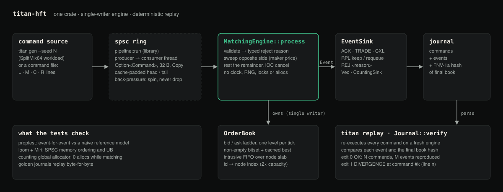
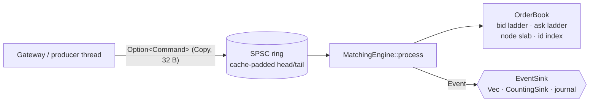

# Titan-HFT


**A small, deterministic single-instrument order-matching engine in Rust: a lock-free SPSC queue, a price-time-priority book that does not allocate while matching, a replayable journal, and benchmarks that state how they were measured.**

[Case study ↗](https://hellpuff.dev/work/titan-hft)



<sub>Diagram of the real modules (`workload`, `spsc`/`pipeline`, `engine`, `book`, `journal`, `titan` CLI). The `titan` CLI drives the engine directly; the SPSC ring is used by `pipeline::run` and the stress tests.</sub>

> **Status: educational / research, v0.1.0.** Not a trading system. No exchange connectivity, no risk checks, no persistence guarantees, no claims about financial returns.

```console
$ cargo run --release --bin titan -- run tests/fixtures/price_time.cmds
> L S 1 101 5
< ACK 1
> L S 2 100 5
< ACK 2
> L S 3 100 5
< ACK 3
> L B 10 101 12
< ACK 10
< TRADE 10 2 100 5
< TRADE 10 3 100 5
< TRADE 10 1 101 2
> L B 11 99 4
< ACK 11
> M S 12 10
< ACK 12
< TRADE 12 11 99 4
< CXL 12 6 ioc
...
hash d7047f180ee3c18a
```

The bid for 12 @ 101 fills order 2 before order 3 (same price, earlier arrival), both before order 1 (worse price), and every trade prints at the **resting** order's price. The market sell fills what it can and cancels the rest (`CXL 12 6 ioc`).

## Why this exists

Most matching-engine examples are either toy code with no tests or production systems too big to learn from. Titan-HFT sits in between. It has:

- a **lock-free SPSC ring buffer** whose every `Acquire`/`Release` is justified in writing ([docs/MEMORY_ORDERING.md](docs/MEMORY_ORDERING.md)), checked by **loom** and **Miri**,
- a **price-time-priority order book** with O(1) cancel and fully preallocated memory,
- an **allocation counter** that tests the zero-allocation claim instead of just asserting it,
- a **replayable journal** so you can prove that the same input yields the same output,
- **benchmarks with methodology**: warm-up, repeated runs, HDR percentiles, machine metadata, and the timer's own resolution reported next to the results.

It is for students, systems programmers learning atomics, and anyone who wants a well-tested baseline to experiment with (different book layouts, queue designs, hashers).

## Quick start

```sh
git clone https://github.com/hellpuffyt/Titan-HFT && cd Titan-HFT
cargo test --release                                   # 73 tests incl. property, fuzz & stress tests
cargo run --release --bin titan -- gen --seed 42 --count 5000 --out flow.cmds
cargo run --release --bin titan -- run flow.cmds --quiet --journal flow.journal
cargo run --release --bin titan -- replay flow.journal
```

Expected last line (real output for seed 42, 5000 commands):

```text
OK: 5000 commands, 8051 events reproduced exactly; final hash 62d641d8087e8866
```

Edit one event in a journal and `replay` exits with code 1 and pinpoints the first divergence. Below, a journal of `tests/fixtures/price_time.cmds` had one `TRADE 10 3 100 5` changed to quantity 4:

```text
DIVERGENCE: divergence at command #3 (line 9): L B 10 101 12
  expected:
    < ACK 10
    < TRADE 10 2 100 5
    < TRADE 10 3 100 4
    < TRADE 10 1 101 2
  actual:
    < ACK 10
    < TRADE 10 2 100 5
    < TRADE 10 3 100 5
    < TRADE 10 1 101 2
```

Requires Rust 1.86+ (edition 2024; `rust-version = "1.86"` in Cargo.toml, set by the Criterion dev-dependency, so Cargo refuses older toolchains for the library too). No other system dependencies.

## Features

**Implemented**
- `spsc`: bounded, wait-free SPSC queue (power-of-two capacity, cache-padded indices, cached remote index, drops in-flight items on teardown).
- `book`: per-tick price ladder + non-empty-level bitset + intrusive FIFO per level + slab of nodes + id→node index. All storage is allocated in `OrderBook::new`.
- `engine`: limit orders, market orders (immediate-or-cancel), cancels, replaces (price and/or quantity; an in-place reduction keeps priority), price-time priority, maker-price execution, explicit reject reasons (`zero_qty`, `qty_too_large`, `bad_tick`, `price_out_of_band`, `duplicate_id`, `unknown_order`, `book_full`).
- `journal`: text journal of commands + events + final book hash; `verify` replays and reports the first divergence.
- `workload`: seeded synthetic order flow (SplitMix64), identical on every platform.
- `pipeline`: producer thread → SPSC → engine thread with back-pressure (spin-retry; never drops).
- `titan` CLI: `run`, `replay`, `gen`.

**Experimental**
- Latency harness (`cargo bench --bench latency`). The numbers are honest but host-dependent; see [docs/BENCHMARKS.md](docs/BENCHMARKS.md).

**Planned** (no code yet; see [docs/good-first-issues.md](docs/good-first-issues.md))
- Self-trade prevention, multiple instruments, binary journal format, core pinning in the harness.

## Architecture



Details, data structures, and complexity table: [docs/ARCHITECTURE.md](docs/ARCHITECTURE.md).

| Operation | Cost |
|---|---|
| best bid/ask | O(1) (cached index) |
| add resting order | O(1) |
| cancel by id | O(1), plus O(L/64) to find the next best level if the best level empties |
| replace, same price + smaller qty | O(1) in place (keeps priority) |
| replace, other cases | cancel cost + O(1) re-insert, plus O(1) per maker order it trades with |
| fill against best level | O(1) per maker order touched |

## Matching rules

1. Price-time priority: better price first; FIFO at equal price.
2. Trades execute at the maker's (resting order's) price.
3. Limit orders match while they cross, then rest the remainder.
4. Market orders are IOC: unfilled remainder → `CXL <id> <qty> ioc`. They never rest.
5. Order ids must be unique among **resting** orders; a fully filled or cancelled id may be reused.
6. Validation happens before any state change; a rejected command changes nothing.
7. No self-trade prevention (there is no account concept).
8. Replace (`R <id> <price> <qty>`) sets a resting order's new price and new **remaining** quantity; the side is unchanged:
   - same price and quantity ≤ remaining → reduced in place, **keeps** time priority (`RPL … keep`);
   - any price change or a quantity increase → **loses** priority: re-entered at the back of the level and, if the new price crosses, matched immediately as the taker (`RPL … requeue`, then `TRADE`s);
   - unknown, filled, or cancelled id → `unknown_order`; invalid values → `zero_qty`, `qty_too_large`, `bad_tick`, `price_out_of_band` (checked in that order, before the id). A rejected replace leaves the order untouched.
   - Replace never returns `book_full`, because the old node is freed before the new one is taken.

## Configuration reference

`BookConfig` / CLI flags:

| Field | CLI flag | Default (CLI) | Meaning |
|---|---|---|---|
| `tick` | `--tick` | 1 | price increment; prices must be multiples |
| `min_price` | `--min` | 1 | lowest accepted limit price (multiple of tick) |
| `max_price` | `--max` | 100000 | highest accepted limit price (multiple of tick) |
| `max_orders` | `--max-orders` | 65536 | resting order pool size (1 ..= 2^30−1) |

The band may span at most 2^22 ticks. Order quantity must be in `1 ..= 2^32`.

Command file lines: `L <B|S> <id> <price> <qty>`, `M <B|S> <id> <qty>`, `C <id>`, `R <id> <price> <qty>`, `# comment`.

`titan gen --replace-pct N` adds N% replaces to the synthetic flow (default 0, which reproduces 0.1.0 flows byte-for-byte).

## Testing

```sh
cargo test                                   # unit, property, stress, fixtures, CLI, allocation
RUSTFLAGS="--cfg loom" cargo test --release --test loom   # loom model checking of the queue
cargo +nightly miri test --lib spsc          # Miri UB check of the queue tests
```

What the suites cover:
- **Differential property test** (`tests/properties.rs`): 512 random command sequences per run are compared event-for-event against a deliberately naive reference model. The model covers limit, market, cancel, and replace. After every command it also checks that the book is never crossed, that quantity is conserved (including replace deltas), and that FIFO order holds at each level, with a requeued replace counting as a new arrival. Planted bugs (split fills; a replace that keeps priority on a quantity increase; a requeue that skips matching) were each caught and shrunk to a minimal counterexample during development.
- **Stress** (`tests/stress.rs`): producer → queue → engine at capacities 1, 2, 64, and 4096 must equal the single-threaded result exactly. Also 2M items through an 8-slot queue, and a leak/double-free check with `Arc` payloads.
- **Allocation** (`tests/alloc.rs`): a counting global allocator shows 0 allocations while matching 500,000 commands (621,360 trades) after warm-up, and 0 from a cold start. With 20% replaces in the flow, it shows 0 allocations over 500,000 commands containing 100,295 replaces.
- **Loom**: verified to fail with a causality violation when the producer's `tail` store is weakened to `Relaxed`, and to pass with `Release`.
- **Robustness** (`tests/robustness.rs`): the journal and command parsers are fuzzed (arbitrary Unicode text, grammar-token soup, single-byte mutations of a valid journal, truncation at every byte, CRLF, `u64` edge values) and must return a typed, line-numbered error or a journal that replays without panicking. 16 adversarial 50,000-command workloads (tiny id space, prices off-band and off-tick, quantities 0 / 2^32 / 2^32+1, a 16-order pool) check after every command that the book is not crossed, the id index and the ladders agree, level totals and counts match their orders, quantity is conserved, and rejected commands change nothing. Every reject reason, partial fills, both replace outcomes and IOC remainders are confirmed to occur. Book and event-stream hashes of three 100,000-command workloads are pinned, so a platform-dependent result fails CI on Linux, macOS, or Windows.
- **Fixtures**: golden journals replay byte-for-byte (including `replace.cmds`, one scenario per replace rule); a tampered journal is detected at the right line; malformed inputs report line numbers (CLI exit code 2).

## Benchmarks

Full methodology, raw output, and caveats: [docs/BENCHMARKS.md](docs/BENCHMARKS.md). The run below was on an Apple M5 (10 cores, 16 GB), macOS 27.0.1, rustc 1.98.0, `bench` profile (opt-level 3, thin LTO, 1 codegen unit). Other workloads were running on the machine (load average 10–15), so treat these as rough indications, not best-case figures.

| Measurement | Result |
|---|---|
| Engine, 100k-command mix (Criterion) | 36.7 M cmd/s (2.72 ms / 100k) |
| Engine, 1M-command mix, no per-op timers (5 runs) | 23.0 – 28.6 M cmd/s |
| Engine per-command latency, 1M × 5 runs | p50 42 ns · p95 167 ns · p99 292 ns · p99.9 458 ns |
| SPSC push+pop, same thread (Criterion) | 3.69 ns |
| SPSC cross-thread round trip (two hops), 1M × 5 | p50 333 ns · p99 541 ns |
| Pipeline producer → SPSC → engine (5 runs) | 17.1 – 18.2 M cmd/s |
| Allocations in the measured matching loop | 0 |

The timer on this machine ticks every ~41.7 ns, so the per-command p50 is at the measurement floor.

Replace-heavy workloads (10% and 30% replaces; reduce-only and move-only mixes), with latency split by outcome, are in [docs/BENCHMARKS.md](docs/BENCHMARKS.md#order-replace-workloads-branch-featorder-replace-2026-10-22). They were measured on a heavily loaded machine, with up to 6× run-to-run spread, so they are reported as spreads, not as stable figures. Every replace run made 0 allocations.

```sh
cargo bench --bench latency     # percentile harness with metadata
cargo bench --bench queue       # Criterion, queue only
cargo bench --bench engine      # Criterion, engine only
```

## Security model

Titan-HFT processes trusted, local input. It is not hardened against adversarial clients:
- the id hasher is a fast, non-keyed mixer (not HashDoS-resistant);
- the journal hash is FNV-1a, which detects accidental divergence, not tampering.

All memory is bounded by `BookConfig`. Inputs are validated, and quantities are capped so level totals cannot overflow. Report vulnerabilities via [SECURITY.md](SECURITY.md).

## Troubleshooting

- **`error: ... line N: ...` and exit code 2**: the command file is malformed; the message names the line and token.
- **`book_full` rejects**: raise `--max-orders`. The pool is fixed by design.
- **`price_out_of_band`**: widen `--min`/`--max`; prices must also be multiples of `--tick`.
- **Benchmark numbers vary a lot**: close other workloads, plug in power, and run several times. If your project lives in a cloud-synced folder, set `CARGO_TARGET_DIR` outside it, since sync daemons can consume a full core.
- **loom test "not found"**: it only exists with `RUSTFLAGS="--cfg loom"`.

## Limitations and roadmap

See [docs/LIMITATIONS.md](docs/LIMITATIONS.md). Key points: single instrument, conservative `book_full` check, fixed price band, no core pinning, and results measured on one machine.

## Contributing

Contributions are welcome. See [CONTRIBUTING.md](CONTRIBUTING.md) and [docs/good-first-issues.md](docs/good-first-issues.md). Please follow the [Code of Conduct](CODE_OF_CONDUCT.md).

## License

Dual-licensed under [MIT](LICENSE-MIT) or [Apache-2.0](LICENSE-APACHE), at your option.
