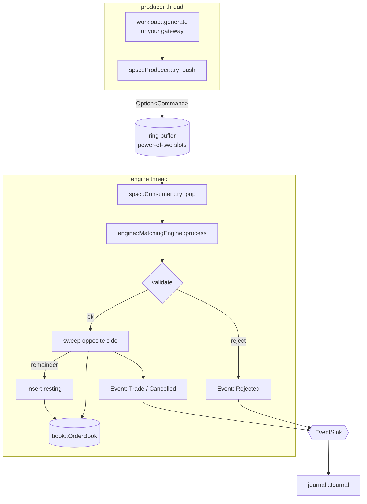

# Architecture

Titan-HFT is one crate with six small modules. Each one can be read on its own.



## Ownership

- The **engine owns the book**. Exactly one thread mutates it, so the book needs no locks or atomics. The single-writer principle is what makes the hot path cheap and deterministic.
- **Commands and events are `Copy`** (`Command` and `Option<Command>` are 32 bytes, `Event` is 40 bytes on 64-bit targets). They move through the queue by value; nothing on the hot path is reference-counted or boxed.
- The **queue owns its slots**. `Producer` and `Consumer` share an `Arc<Shared<T>>` but are not `Clone`, so the type system enforces "single producer, single consumer". Pushing and popping take `&mut self`, so even a shared reference to an endpoint cannot be used to push or pop concurrently.
- **Sinks are borrowed** (`&mut impl EventSink`). The engine never buffers events itself. A caller that wants zero allocation passes a sink that doesn't allocate (`CountingSink`, or one writing into a preallocated ring). A caller that wants convenience passes a `Vec<Event>`.

## The order book

```text
bids: Ladder                     asks: Ladder
  levels[i] ─┬─ head ─► node ─► node ─► node   (FIFO, intrusive doubly-linked)
             ├─ tail ────────────────────┘
             ├─ qty   (sum of resting qty)
             └─ count
  nonempty: [u64]   one bit per level
  best: u32         cached index of best level

nodes: [Node]  fixed-size slab; free list threaded through `next`
index: HashMap<OrderId, u32>  id → node, capacity 2 × max_orders
```

- **Price ladder.** One `Level` per tick in `[min_price, max_price]`, so price → level is a subtraction and a division. This is the classic exchange layout for instruments with a bounded price band. A `BTreeMap<Price, Level>` would allocate a tree node whenever a new price level appears, which would break the zero-allocation property.
- **Best price.** It is cached. When the best level empties, the next one is found by scanning the `nonempty` bitset 64 levels per word, using `leading_zeros`/`trailing_zeros`. That is O(L/64) in the worst case and usually one word.
- **Intrusive FIFO.** Each node stores `prev`/`next` slab indices (`u32`, not pointers), which gives O(1) unlink on cancel without `unsafe` code.
- **Slab + free list.** Nodes are recycled. When the pool is exhausted, the engine returns `book_full`; it never grows.
- **Id index.** `HashMap` with a custom splitmix64 hasher, created with capacity 2 × `max_orders`. hashbrown rehashes *in place* (no allocation) when tombstones accumulate and the load is under half of capacity. Sizing it at 2× ensures that rehashes never need to reallocate. The allocation test checks this.

## Determinism

`MatchingEngine::process` reads no clock, no random numbers, and no environment, and it iterates only over ordered structures (the ladder and the FIFO lists, never the hash map). The same `BookConfig` plus the same command sequence therefore always yields the same events and the same `state_hash()`. The journal records commands, events, and the final hash, and `Journal::verify` re-executes and compares. The property test `same_input_same_output` and the golden fixtures check this property.

## Atomics, memory ordering, false sharing

See [MEMORY_ORDERING.md](MEMORY_ORDERING.md). In short:

- two monotonic counters, each written by exactly one thread;
- a `Release` store publishes data and the paired `Acquire` load receives it, one pair per direction;
- 128-byte padding keeps the counters off each other's cache lines;
- each side caches the other side's counter so the fast path touches only its own line plus the slot.

## Where the time goes (and doesn't)

- No allocation on the matching path (measured; see `tests/alloc.rs`).
- No dynamic dispatch: `process` is generic over the sink.
- No syscalls, locks, or atomics inside the engine; the only atomics are in the queue.
- What still costs: hash-map lookups on cancel and on duplicate-id checks, cache misses on a large ladder, and branch mispredictions on the crossing decision.

## What a production engine would add

These are out of scope here and listed so readers know what is missing: persistence and recovery (write-ahead journal plus snapshots), sequencing across multiple gateways, risk checks, self-trade prevention, order modify, multiple instruments, market-data publishing, kernel-bypass networking, CPU pinning and isolation, and huge pages.
